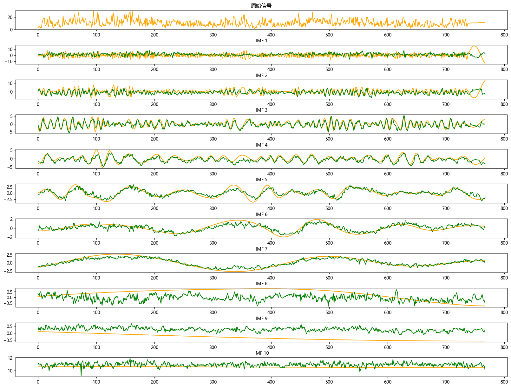
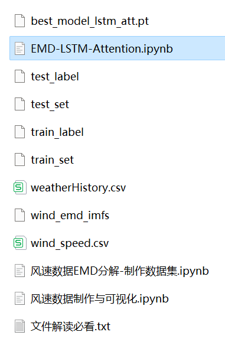
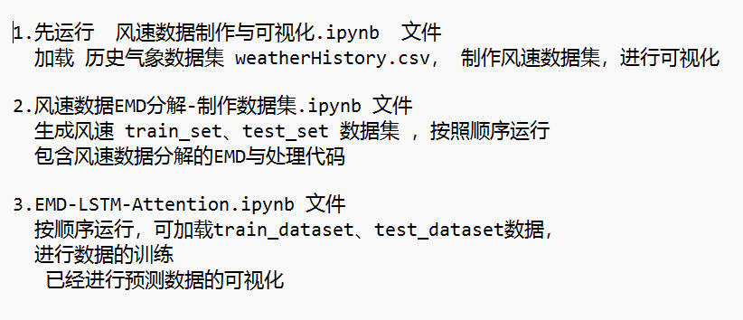
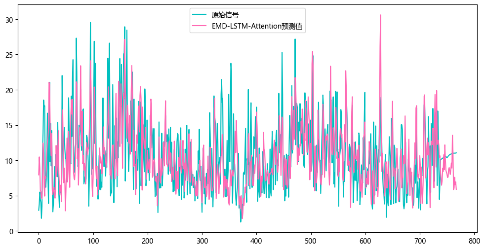

# Stepwise Wind Speed Prediction: EMD-LSTM-Attention (Implemented with PyTorch)

Multi-feature variables include the following:
1. Include wind speed data, as well as preprocessed wind speed datasets and label sets generated through EMD decomposition, which can be run in corresponding codes, and also EMD decomposition examples.
2. Add self-attention mechanism, which significantly improves performance, reducing MSE and MAE.
(When publishing papers, if the effect is not reduced, adding the module is considered innovative)
3. Include code for data EMD preprocessing and EMD-LSTM-Attention prediction.
Environment: Python 3.9
\n        \n      (Platform shows less than the number of files in the image file explanation: The platform has a limit on the number of uploaded files; run the code according to the explanation, and the data can be generated based on the uploaded code)
\n        \n  
\n        \n      \n        \n

## Images

<!-- PAYMENT_BLOCK -->

## Get this dataset

- Payment link (Stripe): [Buy now](https://buy.stripe.com/3cs8yP7sY87d0vu9AB)
- Payment QR code: 

<!-- /PAYMENT_BLOCK -->
